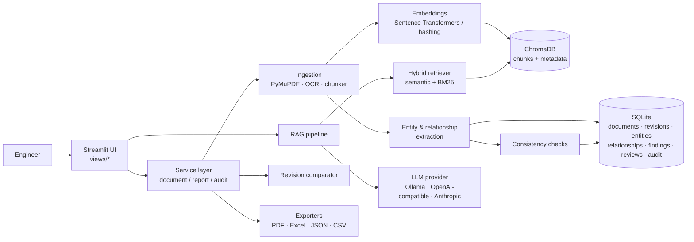

# AutoDoc AI

**Automotive Architecture Intelligence Platform**
*Turn complex automotive software documents into actionable engineering knowledge.*

AutoDoc AI is a local web application that helps automotive software engineers upload, search, analyse and compare
High-Level Design (HLD) documents for AUTOSAR-style software architectures. It turns long, unstructured PDFs into a
searchable, traceable knowledge base: every answer, extracted entity and finding points back to the page it came from.

It implements **Case Study 1 — AUTOSAR HLD Document Analysis Assistant** of the *Automotive Engineering AI — Standard
Project Case Study Document*. It is an academic prototype that **assists** engineers; it does not approve designs and
does not establish safety, AUTOSAR conformance or regulatory compliance.

---

## Contents

1. [Problem statement and objectives](#problem-statement-and-objectives)
2. [Main features](#main-features)
3. [Technology stack](#technology-stack)
4. [System architecture and RAG workflow](#system-architecture-and-rag-workflow)
5. [Project structure](#project-structure)
6. [Installation](#installation)
7. [Configure the LLM](#configure-the-llm)
8. [Run the application](#run-the-application)
9. [Sample documents and first demo](#sample-documents-and-first-demo)
10. [Run the tests](#run-the-tests)
11. [Troubleshooting](#troubleshooting)
12. [Security and privacy](#security-and-privacy)
13. [Known limitations](#known-limitations)
14. [Future enhancements](#future-enhancements)

---

## Problem statement and objectives

HLD documents describe software components, ports, interfaces, signals, dependencies and functional flows. They are
often hundreds of pages long and maintained as PDFs, so architects, integrators and testers interpret them manually.
Without structured extraction it is hard to find mismatches, missing dependencies or inconsistent terminology.

**Objectives** (from the case study): reduce manual review effort; build a structured, searchable repository of
architecture knowledge; improve component/interface/signal/dependency traceability; support design reviews,
onboarding, impact analysis and test planning.

## Main features

| Area | What it does |
|---|---|
| **Document management** | PDF upload with extension, MIME, size, page-count and PDF-validity checks; SHA-256 duplicate detection; generated storage IDs (no path traversal, no overwrites); explicit document → revision versioning; "draft / approved / superseded" source-status label; page viewer; confirmed deletion of file, vectors and records. |
| **Ingestion pipeline** | Page-by-page text extraction with PyMuPDF; heading and section detection; table extraction; low-text page detection; OCR with Tesseract when installed; section- and page-aware chunking; embeddings in a persistent ChromaDB collection; idempotent re-processing; failed runs are never marked processed. |
| **Ask the Document (RAG)** | Hybrid semantic + BM25 keyword retrieval restricted to the selected revision; controlled prompt with untrusted-content handling; answers cite `[S1]`-style sources mapped to page and section; invalid citations removed; explicit *insufficient evidence* and *retrieval-only* modes; conversation history; Markdown export; exact "find every mention" search. |
| **Architecture extraction** | Deterministic parsing of component, port, interface, signal and dependency tables; prose patterns for dependencies, responsibilities and functional flows; optional LLM extraction validated with Pydantic and a verbatim-evidence guardrail; deduplication that keeps every occurrence; review workflow (confirm / correct / reject). |
| **Architecture Explorer** | Searchable inventory with filters; component detail view (responsibilities, ports, interfaces, signals, relationships, flows, source pages); interactive dependency graph built only from documented relationships; CSV/JSON export of selected entities. |
| **Revision comparison** | Section-level text diff (renumbering tolerant), entity and relationship diffs, documented relationships affected by changes, structural-similarity warning, optional AI summary clearly labelled as inference; JSON / Excel / PDF exports; change-impact findings. |
| **Findings & Review** | 13 transparent rules (duplicate IDs, missing names/descriptions, empty interfaces, undefined interfaces, unresolved dependencies, undefined component mentions, signals missing from the inventory, signal endpoints, conflicting descriptions, components without ports, extraction-coverage warnings). Each finding has an ID, category, severity, evidence, pages, detection method and an *evidence kind* that separates missing evidence from observed problems. Accept / reject / investigate with comments. Optional AI review stored as unverified suggestions. |
| **Reports & export** | PDF report, Excel inventory, JSON, CSV (entities, relationships, findings), AI flow summaries with citations. Only stored results are used. |
| **Settings & status** | LLM, embedding, ChromaDB, SQLite, OCR and package status; runtime configuration (never secrets); setup guide; audit log. |
| **Audit trail** | Uploads, processing results, questions, extraction and check runs, comparisons, reports, reviews, deletions and settings changes — identifiers and metadata only, never document text or keys. |

## Technology stack

| Layer | Technology |
|---|---|
| UI | Streamlit 1.65 (multipage navigation, custom theme/CSS), Plotly |
| Application | Python ≥ 3.11 (tested on 3.13), modular service layer — no separate API server is needed for the pilot |
| PDF processing | PyMuPDF (text, layout, tables, page rendering), Tesseract via pytesseract (OCR) |
| Embeddings | Sentence Transformers (default `BAAI/bge-small-en-v1.5`), or an offline hashing embedder |
| Vector store | ChromaDB (persistent, local, cosine similarity, metadata filters) |
| Keyword search | BM25 implemented in-process |
| LLM | Provider abstraction: OpenAI SDK (OpenAI or any OpenAI-compatible local server), Anthropic SDK, Ollama (local) |
| Structured data | SQLite via SQLAlchemy 2, Pydantic models for extraction |
| Graph | NetworkX + Plotly |
| Exports | pandas, OpenPyXL, ReportLab |
| Tests | pytest, Streamlit AppTest |
| Deployment | Optional Docker / Docker Compose |

## System architecture and RAG workflow



**Question answering, step by step**

1. The question is embedded (with the model's query prefix where required).
2. ChromaDB returns the closest chunks, filtered to the selected revision; BM25 keyword scores are combined with the
   semantic score (`HYBRID_KEYWORD_WEIGHT`).
3. Results are re-checked in Python so that only the selected revision can appear (document isolation).
4. If no chunk reaches the relevance threshold, the app answers **"insufficient evidence"** without calling the LLM.
5. The most relevant chunks are placed, escaped, inside `<source label="S1" page="4" …>` tags. The system prompt tells
   the model to answer only from them, cite labels, separate inferences, say when evidence is missing, ignore
   instructions found in the document, never reveal configuration and never claim compliance or approval.
6. Citations in the answer are validated; references to sources that were not supplied are removed; an uncited answer
   is flagged as unverified.
7. The UI shows the answer, the cited pages and every retrieved excerpt, and stores the exchange.

Defaults: chunk size 900 characters, overlap 150, top-k 6, keyword weight 0.35, relevance threshold 0.35
(semantic) / 0.15 (hashing). All are configurable on the Settings page or in `.env`.

More detail: [`docs/architecture.md`](docs/architecture.md).

## Project structure

```
autodoc-ai/
├── app.py                     # Streamlit entry point (navigation, theme, sidebar)
├── views/                     # One file per page (dashboard, documents, chat, explorer, comparison, findings, reports, settings)
├── config/settings.py         # Typed configuration from defaults, .env and saved overrides
├── src/
│   ├── ingestion/             # pdf_parser, ocr, chunker, processor (pipeline)
│   ├── ai/                    # embeddings, retrieval (ChromaDB + BM25), llm_provider, prompts, rag_pipeline
│   ├── architecture/          # entity_extractor, relationship_extractor, graph_builder
│   ├── analysis/              # revision_comparator, consistency_checker
│   ├── database/              # SQLAlchemy models, repository, initialization
│   ├── services/              # document_service, report_service, audit_service
│   ├── exports/               # csv, excel, pdf, json exporters
│   ├── ui/                    # shared UI components and cached resources
│   └── utils/                 # file validation, logging (with secret redaction), errors
├── scripts/generate_sample_data.py
├── sample_data/               # synthetic HLD revisions A and B + demo questions
├── tests/                     # pytest suite (90 tests)
├── docs/                      # architecture, user guide, testing, implementation notes
├── assets/                    # logo and icon
├── .streamlit/config.toml     # theme and server settings
├── data/ uploads/ chroma_db/  # runtime storage (created automatically, empty in the ZIP)
├── requirements.txt  .env.example  Dockerfile  docker-compose.yml  pytest.ini
```

The pages live in `views/` rather than `pages/`: Streamlit treats a folder called `pages/` as a legacy auto-navigation
folder, which conflicted with the explicit navigation (deep links would bypass the theme and sidebar).

## Installation

**Prerequisites:** Python 3.11 or newer, ~3 GB disk space (PyTorch + models), internet access on first run to download
the embedding model. Optional: [Tesseract OCR](#ocr-for-scanned-pdfs), [Ollama](https://ollama.com) for a local LLM.

### macOS / Linux

```bash
cd autodoc-ai
python3 -m venv .venv
source .venv/bin/activate
pip install --upgrade pip
pip install torch --index-url https://download.pytorch.org/whl/cpu   # optional: smaller CPU-only PyTorch
pip install -r requirements.txt
cp .env.example .env
```

### Windows (PowerShell)

```powershell
cd autodoc-ai
py -3.11 -m venv .venv
.venv\Scripts\Activate.ps1          # in cmd.exe: .venv\Scripts\activate.bat
python -m pip install --upgrade pip
pip install torch --index-url https://download.pytorch.org/whl/cpu   # optional: smaller CPU-only PyTorch
pip install -r requirements.txt
copy .env.example .env
```

If PowerShell blocks the activation script, run `Set-ExecutionPolicy -Scope CurrentUser RemoteSigned` once.

### OCR for scanned PDFs

* **Windows:** install Tesseract from <https://github.com/UB-Mannheim/tesseract/wiki> and set
  `TESSERACT_CMD=C:\Program Files\Tesseract-OCR\tesseract.exe` in `.env`.
* **macOS:** `brew install tesseract`
* **Debian/Ubuntu:** `sudo apt-get install tesseract-ocr`

Without Tesseract, text-based PDFs work normally; scanned documents are detected and marked **Needs OCR** with
instructions instead of being silently accepted.

## Configure the LLM

A language model is **optional**. With `LLM_PROVIDER=none` the app runs in retrieval-only mode: upload, extraction,
evidence retrieval with citations, comparison, checks and all exports still work. Edit `.env`, then restart.

| Option | `.env` | Leaves your computer? |
|---|---|---|
| Ollama (local) | `LLM_PROVIDER=ollama`, `LLM_MODEL=llama3.1:8b` — first run `ollama pull llama3.1:8b` | No |
| OpenAI-compatible local server (LM Studio, llama.cpp, vLLM) | `LLM_PROVIDER=openai`, `LLM_BASE_URL=http://localhost:1234/v1`, `LLM_MODEL=<served model>` | No |
| OpenAI API | `LLM_PROVIDER=openai`, `LLM_MODEL=<model id>`, `OPENAI_API_KEY=…` | Yes — the question and retrieved excerpts |
| Anthropic API | `LLM_PROVIDER=anthropic`, `LLM_MODEL=<model id>`, `ANTHROPIC_API_KEY=…` | Yes — the question and retrieved excerpts |

Check each provider's documentation for current model identifiers. Provider, model, base URL, temperature, token limit
and timeout can also be changed on **Settings & Status → Configuration**; API keys are read only from the environment
and never stored, logged or displayed. Before excerpts are sent to an external API, the chat page asks for confirmation.
The app never falls back from one provider to another.

**Embeddings:** the default model `BAAI/bge-small-en-v1.5` (~130 MB) is downloaded from Hugging Face on first use and
cached. For machines without internet access, set `EMBEDDING_BACKEND=hashing` (lexical matching only, lower quality).
Changing the embedding model requires re-processing documents; the app detects and flags this.

## Run the application

```bash
streamlit run app.py
```

Open <http://localhost:8501>. Directories (`data/`, `uploads/`, `chroma_db/`) and the database are created
automatically on first start. With Docker: `docker compose up --build` (the port is bound to localhost only).

## Sample documents and first demo

Two synthetic HLD revisions are included in `sample_data/` (regenerate with `python scripts/generate_sample_data.py`).

**Recommended demonstration (about 10 minutes):**

1. **Documents → Upload:** upload `EBC_HLD_Synthetic_RevA.pdf` as a new document (revision label `A` is detected).
   Processing shows chunks, tables, entities and findings.
2. **Ask the Document:** ask *"What is the unit and range of Sig_VehicleSpeed?"* — the answer cites page 4. Ask
   *"What is the ASIL rating of the BrakeTorqueCoordinator?"* — the app reports insufficient evidence.
3. **Architecture Explorer:** open *BrakeTorqueCoordinator*, then the **Dependency graph** — `PedalInputHandler`
   appears as an orange "referenced, not defined" node.
4. **Findings & Review:** the duplicate identifier `C-05` (High), the empty `IF_DiagEvent`, the undefined
   `IF_ActuatorStatus`; accept one finding with a comment.
5. **Documents → Upload:** upload `EBC_HLD_Synthetic_RevB.pdf` as *a new revision of an existing document* (label `B`).
6. **Revision Comparison:** A → B shows `PedalInputHandler` added, `HmiWarningManager` removed, the `Sig_VehicleSpeed`
   unit change and the new *Degraded Mode Handling* section; export the comparison as Excel or PDF.
7. **Reports & Export:** prepare and download the PDF report and Excel inventory.

`sample_data/demo_questions.json` lists more questions and the pages a correct answer must cite. A full walkthrough is
in [`docs/user_guide.md`](docs/user_guide.md).

## Run the tests

```bash
python -m pytest            # whole suite (~4 minutes on a laptop CPU)
python -m pytest -k retrieval
```

The tests need no API key and no network: they use the offline hashing embedder, mocked LLM providers and the
synthetic samples, plus a tiny randomly initialised Sentence-Transformers model built on the fly to exercise the
semantic backend. See [`docs/testing.md`](docs/testing.md) for the test catalogue and the latest results.

## Troubleshooting

| Symptom | Fix |
|---|---|
| *"The embedding model … could not be loaded (ConnectionError/ProxyError)"* | First run needs internet to download the model. Retry online, or set `EMBEDDING_BACKEND=hashing`. |
| Revision shows **Needs OCR** | The PDF is scanned. Install Tesseract (see above), make sure OCR is enabled in Settings, then **Re-process**. |
| "Indexed with a different embedding model" | You changed the embedding model. Re-process the revision on the Documents page. |
| Chat says *retrieval-only mode* | No LLM configured. Set `LLM_PROVIDER` and `LLM_MODEL` in `.env` and restart. |
| Ollama errors | Start `ollama serve`, then `ollama pull <model>`; the Settings page lists installed models. |
| `401` / authentication error | Check the API key in `.env` and restart the app. |
| Rate-limit or timeout errors | Wait and retry, lower `RETRIEVAL_TOP_K`, or raise `LLM_TIMEOUT_SECONDS`. |
| Upload rejected for size | Raise `AUTODOC_MAX_UPLOAD_MB` in `.env` **and** `maxUploadSize` in `.streamlit/config.toml`. |
| `ModuleNotFoundError` | Activate the virtual environment and run `pip install -r requirements.txt`. |
| Start fresh | Stop the app and delete the contents of `data/`, `uploads/` and `chroma_db/`. |

## Security and privacy

* Treat uploaded documents as confidential. Files are stored locally under generated identifiers; nothing is shared or
  published.
* **No authentication is implemented.** This prototype is intended for a single user on a trusted machine or network.
  Do not expose it to the internet without adding access control (Docker Compose binds to `127.0.0.1` for this reason).
* Uploads are validated (extension, MIME, PDF header, PyMuPDF open, size and page limits); files are never executed;
  paths are generated and checked to stay inside the storage folders.
* Secrets come only from environment variables, are redacted from logs and never shown or saved by the app.
* Retrieval is filtered by revision at the database level and re-checked in code.
* Document text is escaped and declared untrusted in prompts, so instructions embedded in a PDF are treated as content.
* External providers receive only the question and retrieved excerpts (or, for AI extraction/review, excerpts or the
  extracted inventory) and only after the user confirms. Local options (Ollama, local OpenAI-compatible servers) keep
  everything on the machine.
* CSV/Excel exports neutralise spreadsheet formulas that could come from document text.
* Dependencies are pinned in `requirements.txt`. The application has not been independently security-audited and is
  not certified for production or enterprise use.

## Known limitations

* Extraction targets tables and text. Relationships drawn only in diagrams or images are not interpreted; pages with
  little text are flagged for manual review.
* The deterministic table parser recognises common header names (Component, Port, Interface, Signal, Source/Target…).
  Unusual layouts are reported as *unrecognised tables*; AI-assisted extraction can help but needs review.
* Relevance thresholds are heuristics, not calibrated probabilities; tune them with your own documents.
* AI answers depend on the chosen model; small local models may cite less reliably (uncited answers are flagged).
* No user accounts, roles or multi-project isolation beyond per-revision retrieval filtering.
* Only PDF input is supported. ARXML, Word or Excel inputs are not parsed.
* Processing runs inside the Streamlit session; very large documents block that browser tab until done.
* Extraction quality has been verified on the synthetic sample only; precision/recall on real HLDs has not been measured.

## Future enhancements

FastAPI service layer with authentication and role-based access; background job queue; ARXML import; diagram
understanding with a vision model; Neo4j traceability to requirements, HARA/TARA and tests; evaluation harness with
precision/recall on annotated HLDs; PostgreSQL; multi-project workspaces.

---

*AutoDoc AI is an academic prototype. AI-generated content must be reviewed by a qualified engineer before it is used
for design approval, compliance, software release or vehicle validation.*
