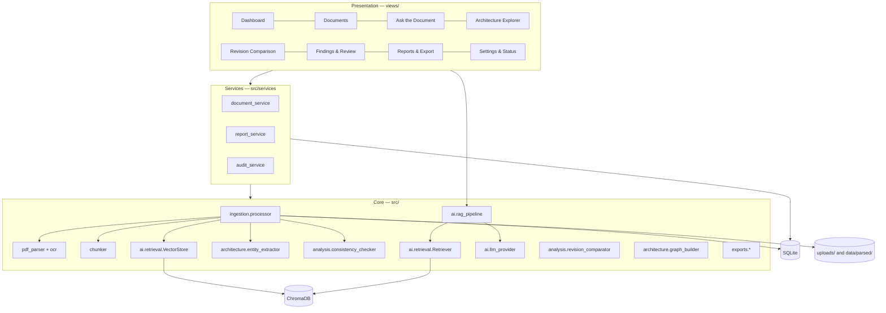
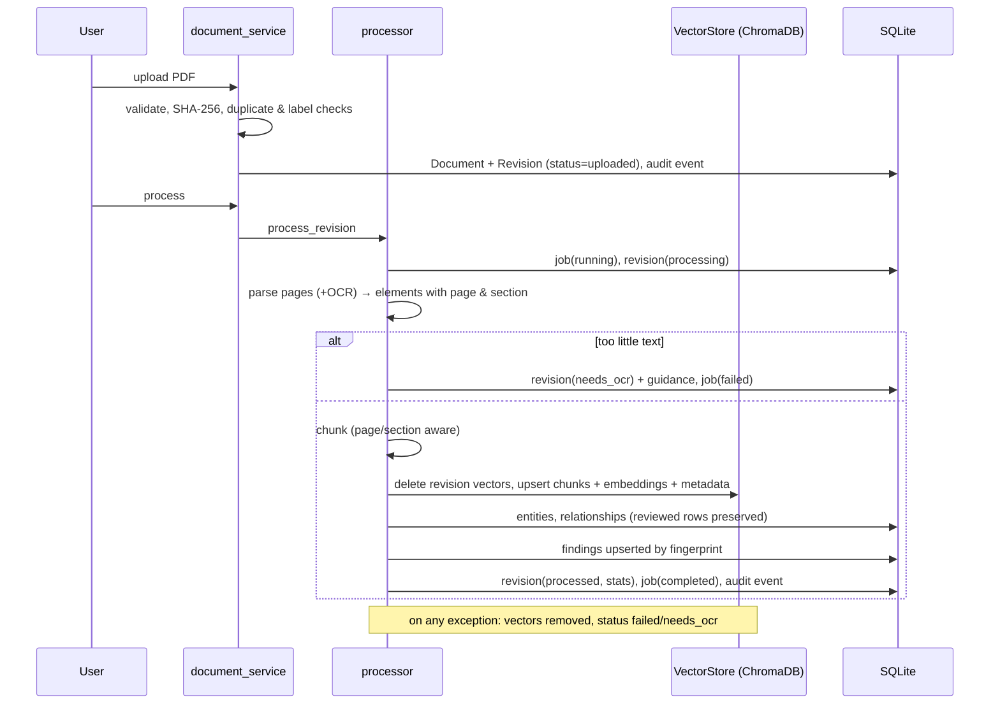
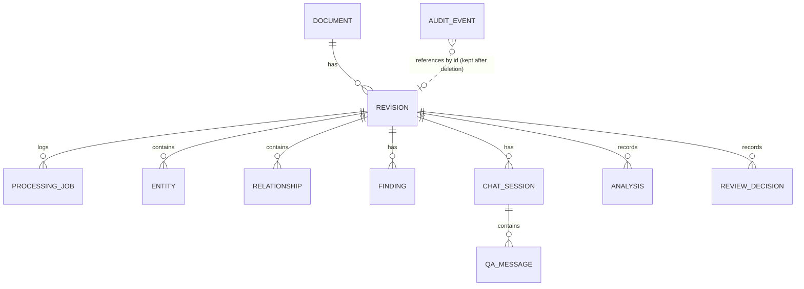

# AutoDoc AI — Architecture

This document describes component responsibilities, data flow and the data model. It maps the common reference
architecture of the case-study document (pages 24–26) onto a single-machine pilot.

## 1. Mapping to the reference architecture

| Reference layer | AutoDoc AI implementation |
|---|---|
| User interface | Streamlit app (`app.py`, `views/`) with custom theme |
| Application and API | In-process service layer (`src/services/`). FastAPI was deliberately not added: one user, one process, no external API consumers in the pilot. The services are UI-independent, so an API can wrap them later. |
| AI orchestration | Custom Python RAG pipeline (`src/ai/rag_pipeline.py`) with controlled prompts, citation validation and guardrails |
| LLM inference | Provider abstraction (`src/ai/llm_provider.py`): Ollama, OpenAI-compatible (local or hosted), Anthropic |
| Embedding service | `src/ai/embeddings.py`: Sentence Transformers (BGE/E5/MiniLM) or offline hashing |
| Local vector store | ChromaDB persistent client (`src/ai/retrieval.py`), one collection per embedding model |
| Structured store | SQLite through SQLAlchemy (`src/database/`) |
| Graph / traceability | NetworkX graph built on demand from stored relationships (`src/architecture/graph_builder.py`) |
| Ingestion | PyMuPDF + Tesseract (`src/ingestion/`) |
| Operations and security | Input validation, path confinement, secret redaction, audit log, optional Docker |

## 2. Component diagram

## 3. Responsibilities

| Module | Responsibility |
|---|---|
| `config/settings.py` | Typed settings from defaults → `.env` → saved non-secret overrides; validation and clamping; secrets read on demand only. |
| `src/utils/file_validation.py` | Extension/MIME/size/page checks, PDF open check, filename sanitising, generated storage paths, path confinement. |
| `src/ingestion/pdf_parser.py` | Per-page elements (heading / paragraph / table) with page numbers; body-font-relative heading detection; table cells read per cell to keep identifiers intact; low-text detection; OCR fallback; revision-label detection. |
| `src/ingestion/ocr.py` | Tesseract availability probe and per-page OCR, with platform-specific install guidance. |
| `src/ingestion/chunker.py` | Chunks never cross page or section boundaries; tables become their own chunks with repeated headers; sentence-aware splitting with overlap. |
| `src/ingestion/processor.py` | Orchestrates a processing run, writes job records, guarantees cleanup and correct status on failure, caches the parsed structure as JSON. |
| `src/ai/embeddings.py` | Lazy, cached embedding models; BGE/E5 query/passage prefixes; offline hashing embedder; shared identifier-aware tokenizer. |
| `src/ai/retrieval.py` | ChromaDB wrapper (upsert, delete by revision, filtered query) and hybrid retriever (semantic + BM25 with query-coverage weighting) with isolation re-check. |
| `src/ai/prompts.py` | System prompts and escaped `<source>` context formatting. |
| `src/ai/rag_pipeline.py` | Relevance gating, context budgeting, LLM call, citation validation, answer modes. |
| `src/ai/llm_provider.py` | Provider classes, external/local classification, uniform error mapping with redaction. |
| `src/architecture/entity_extractor.py` | Pydantic models, table classification and parsing, prose patterns, merging/deduplication, stable IDs, LLM-output validation. |
| `src/architecture/relationship_extractor.py` | Endpoint resolution; derived requirer→provider links from port tables (labelled as derived). |
| `src/architecture/graph_builder.py` | Graph of components and documented relationships; layered layout; Plotly rendering. |
| `src/analysis/consistency_checker.py` | Rule catalogue and deterministic checks; optional AI observations stored as suggestions. |
| `src/analysis/revision_comparator.py` | Section, entity and relationship diffs; affected-relationship analysis; change-impact findings; digest for AI summaries. |
| `src/services/*` | Upload/process/delete/compare workflows, report data assembly, audit recording. |
| `src/exports/*` | CSV (formula-safe), Excel, PDF and JSON writers. |

## 4. Processing data flow

Chunk metadata stored in ChromaDB: `document_id`, `document_name`, `revision_id`, `revision_label`, `page_number`,
`section_heading`, `chunk_index`, `chunk_type` (text/table), `extraction_method` (text/ocr), `content_hash`.
Chunk IDs are `"{revision_id}:{chunk_index}:{content_hash}"`.

## 5. Data model (SQLite)

| Table | Key contents |
|---|---|
| `documents` | id, title, description |
| `revisions` | revision label, source status (draft/approved/superseded), original + stored filename, SHA-256, size, pages, processing status and message, chunk/table/OCR counts, embedding backend+model, sections and low-text pages (JSON) |
| `processing_jobs` | stage, status, message, statistics |
| `entities` | type, name, normalised name, external ID, description, component, attributes (incl. all occurrences), page, section, evidence, method, confidence, review status, reviewer comment |
| `relationships` | source, target, relation type, via, page, section, evidence, method, confidence, review status |
| `findings` | code (F-001…), fingerprint, rule, category, severity, summary, explanation, evidence, pages, detection method, AI flag, evidence kind, review status, comment, active flag |
| `review_decisions` | target type/id, decision, comment, reviewer, time |
| `chat_sessions` / `qa_messages` | question, answer, mode, citations (JSON), provider, model, latency |
| `analyses` | comparison / check / AI-extraction runs with summaries |
| `audit_events` | event type, target, small metadata JSON |
| `schema_info` | schema version |

**Deletion behaviour:** deleting a revision removes its PDF, parsed cache, vectors (in every AutoDoc collection) and
all dependent rows via `ON DELETE CASCADE`; the parent document is removed when its last revision goes. Audit events are
retained. Large text is not duplicated in SQLite: chunk text lives in ChromaDB and the parsed structure in
`data/parsed/<revision>.json`.

**Re-runs:** deterministic extraction replaces only *unreviewed* rows of the same extraction methods; reviewed rows
survive. Findings are matched by a fingerprint of rule + key; existing findings keep their review status, new ones are
added, and open findings that no longer reproduce are deactivated.

## 6. RAG pipeline

See README → *System architecture and RAG workflow*. Answer modes: `answered`, `answered_uncited`,
`insufficient_evidence`, `retrieval_only`, `provider_error`. The relevance score shown in the UI is a ranking score
(weighted cosine similarity and normalised BM25), not a probability of correctness.

## 7. Security model (prototype)

Single trusted user, local process, no authentication. Controls: input validation, generated storage paths with
confinement checks, no execution of uploads, revision-scoped retrieval, untrusted-content prompting with HTML escaping
of document text, citation validation, secret redaction in logs, no secrets in UI or saved settings, explicit
confirmation before sending excerpts to external APIs, formula-safe spreadsheet exports, localhost-only Docker port.
